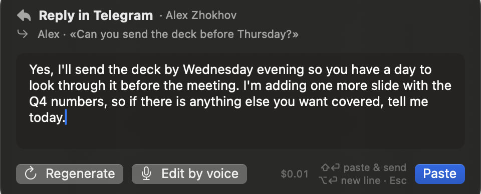
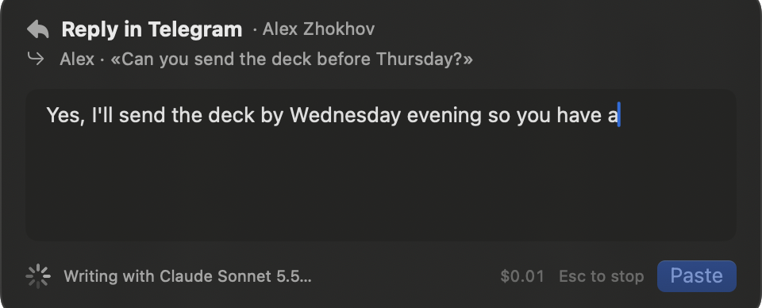
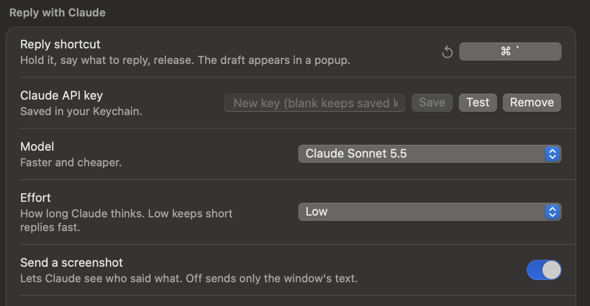

# Reply with Claude

Hold a second shortcut in any chat, email or text field, say what you want to
reply, and Claude writes the reply from what is on your screen. The draft opens
in a popup where you can edit it, ask for another variant or say a change. Return
pastes it into the app. BetterWispr never sends a message for you unless you
press Shift+Return.

## What you need

- An Anthropic API key. Create one at
  [console.anthropic.com](https://console.anthropic.com/settings/keys) and paste
  it under **Settings → Reply with Claude**. It is stored in the macOS Keychain.
- **Accessibility** access, so BetterWispr can read the window's text and paste
  the reply. Dictation needs it already.
- **Screen Recording** access, so Claude can see the screenshot. Without it the
  reply is written from the window's text alone, which works in Slack, Mail and
  most web apps, but not in Telegram, which exposes no text to Accessibility.
  Add the app under System Settings → Privacy & Security → Screen & System Audio
  Recording, then open BetterWispr again.

## How to use it

1. Click into the chat or email you want to answer. Select a message first if
   you want to reply to that one in particular.
2. Hold the reply shortcut (⌥⇧ Space by default) and say what to reply, in any
   language: "tell him I can't make it tomorrow, suggest Thursday", or "ответь,
   что документ пришлю вечером".
3. Release. While you were speaking, BetterWispr read the window's text, took a
   screenshot of it and opened the connection to Anthropic, so the draft starts
   streaming into the popup right away.

   

4. Read the draft. Edit it in place, or:

   | Keys | Action |
   | --- | --- |
   | **⏎** | Paste the draft into the app. Nothing is sent. |
   | **⇧⏎** | Paste and press Return in the app, which sends in Telegram, Slack, WhatsApp and iMessage. In Mail, Return is a line break. |
   | **⌥⏎** | New line in the editor. |
   | **⌘R** | Another, noticeably different variant. After you edit the text by hand, ⌘R reworks your version instead. |
   | **⌘E** or hold the reply shortcut | Say a change, such as "shorter" or "add that I'll call him". The change is applied to the draft; say another one to stack them. |
   | **Esc** | Close. Nothing is pasted and the clipboard is untouched. During generation, Esc stops it. |

The popup's header names the app and window, and the line under it says who
Claude is answering and quotes the message it chose, so you can tell at a glance
when it picked the wrong one. The footer shows what this reply has cost so far at
the model's list price, including variants and edits.

If the app you were in quits before you paste, the draft is copied to the
clipboard instead, and a toast says so.

## Settings

| Setting | What it does |
| --- | --- |
| **Reply shortcut** | Hold it to speak an instruction. It cannot be the same as the dictation shortcut. |
| **Claude API key** | Saved in the Keychain. **Test** sends one tiny request to check the key. **Remove** deletes it. |
| **Model** | Claude Opus 5.5 (best writing), Sonnet 5.5 (faster and cheaper) or Haiku 5.5 (fastest). |
| **Effort** | How long Claude thinks before writing. Low keeps short chat replies fast; High helps with long emails. |
| **Send a screenshot** | On by default. The screenshot lets Claude tell who said what from the chat layout. Off sends only the window's text. |
| **Your name** | Helps Claude tell which messages are yours in group chats and email threads. Prefilled from your macOS account. |

Writing modes and tones apply to replies too. A mode's instructions for an app
or website (**Style → Modes**) and the tone you set for an app category go to
Claude as a standing preference that wins over the conversation's own tone.

## History and cost

Every pasted reply is saved to History like a dictation. The raw text is your
spoken instruction plus any spoken edits, the final text is what was pasted, and
the entry records who it answered and what it cost. Turning History off in
Settings stops this as well.

Costs are computed from the token counts the API reports, at the list prices of
October 2026. A short chat reply with a screenshot costs about a cent on Opus 5.5
and well under a cent on Sonnet or Haiku. Regenerations and edits reuse the
screenshot through prompt caching, so they cost a fraction of the first draft.

## What is sent, and when

- Only while you use the reply shortcut. Dictation, meetings and everything else
  stay as they were: on your Mac unless you chose an API connection for them.
- One request per draft, variant or edit, to `api.anthropic.com` with your key.
  It carries the spoken instruction, the focused window's title and text, the
  selected text, your name, the app's name, the matching writing mode, and, if
  enabled, a JPEG screenshot of the focused window.
- The screenshot is never taken while a password field has focus (macOS secure
  input) or from BetterWispr's own windows.
- Text read from the window is marked as data in the prompt. Instructions that
  appear inside a chat or a web page are not followed.
- Nothing is kept on the server beyond Anthropic's own API retention; see
  Anthropic's terms for your account.

## Troubleshooting

- **"Switch apps" toast when you press the shortcut**: BetterWispr itself was
  the frontmost app. Click into the app you want to reply in first.
- **"Nothing could be read from …"**: neither window text nor a screenshot was available.
  Usually Screen Recording is missing; the popup offers to open the right pane.
  **Send anyway** writes a reply from the instruction alone.
- **The draft answers the wrong person**: select their message before you speak,
  or say the name in the instruction. Check that **Your name** matches how the
  chat shows you.
- **The reply was cut off**: the model ran out of room, which happens with very
  long emails on High effort. Press Retry, or switch to Low effort.
- **The Test button fails with a valid key**: check that the key has access to
  the selected model in the Anthropic console, and that nothing blocks
  `api.anthropic.com` on your network.

## For developers

The flow is described under "Reply flow" in [architecture.md](architecture.md),
and the manual checklist is under "Reply mode checklist" in
[testing.md](testing.md). The core pieces are `ReplyRequest`, `ReplyPrompt` and
`ClaudeClient` in `Sources/BetterWisprCore/Reply`, `WindowSnapshot` for the
screenshot, and `ReplyController`, `ReplyPanel` and `ReplyView` in the app.

The screenshots on this page come from a debug build started with
`BETTERWISPR_REPLY_DEMO=preview` (or `generating`, or `settings`), which opens the
popup with made-up content; adding `BETTERWISPR_REPLY_DEMO_OUT=<dir>` writes a PNG
of each window there.
